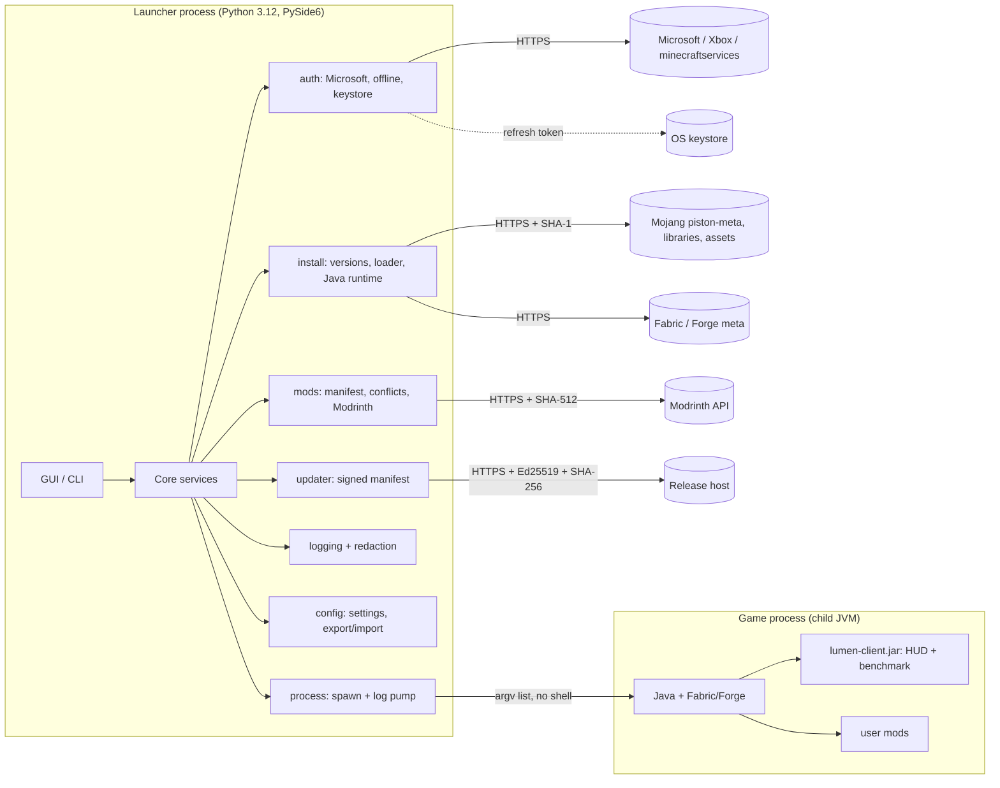

# Architecture

## Modules (src/lumen)
| Module | Responsibility |
|---|---|
| `auth/microsoft.py` | Device-code OAuth -> XBL -> XSTS -> Minecraft token -> profile (404 = game not owned) |
| `auth/store.py` | Refresh token in OS keystore only; JSON index of non-secret metadata; refuses plaintext fallback |
| `auth/offline.py` | Offline profile with vanilla-compatible UUID; gated on prior verified ownership |
| `launch/service.py` | Install vanilla + Fabric/Forge, resolve Mojang Java runtime, build the launch command |
| `launch/jvm.py` | Heap sizing and standard HotSpot flags per profile |
| `launch/process.py` | `Popen(argv, shell=False)`, redacted log pump |
| `mods/manifest.py` | Parse `fabric.mod.json`; dependency/breaks/conflicts/duplicate detection |
| `mods/modrinth.py` | Resolve + download mods, SHA-512 verified |
| `net/verify.py` | Hashing, atomic downloads (HTTPS only), zip-slip-safe extraction |
| `updater/updater.py` | Ed25519-signed manifest, version compare, staged download |
| `config.py`, `logging_setup.py` | Secret-free settings with export/import; rotating redacted logs |

## Key decisions
- **Python 3.12, PySide6 (LGPL)**: native-looking, one codebase for Win/macOS/Linux. Business logic is UI-free so CLI and tests share it.
- **minecraft-launcher-lib** for install/command building: it tracks Mojang's manifest format (rules, natives, Java runtimes) so we don't.
- **Our client is a mod, not a patched Minecraft jar**: redistributing modified Mojang code is not permitted; a Fabric mod is.
- **Device-code OAuth**: no embedded browser, no client secret in a distributable app.
- **One-folder PyInstaller bundle**: faster start, fewer antivirus false positives than one-file.
- **Process boundary**: the game runs as a separate JVM, so a game crash never takes down the launcher and tokens are passed only as launch args.
